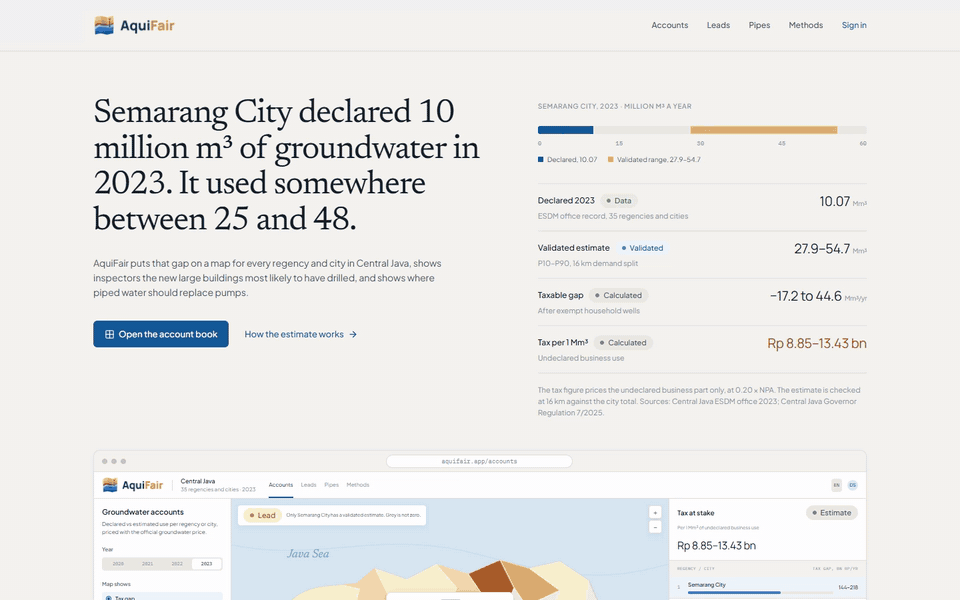
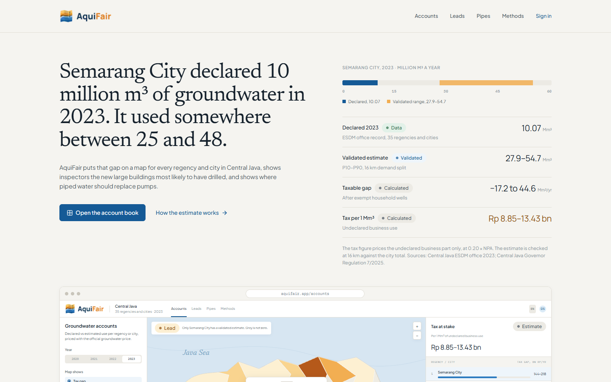
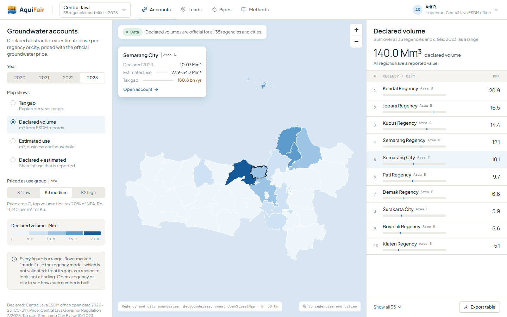
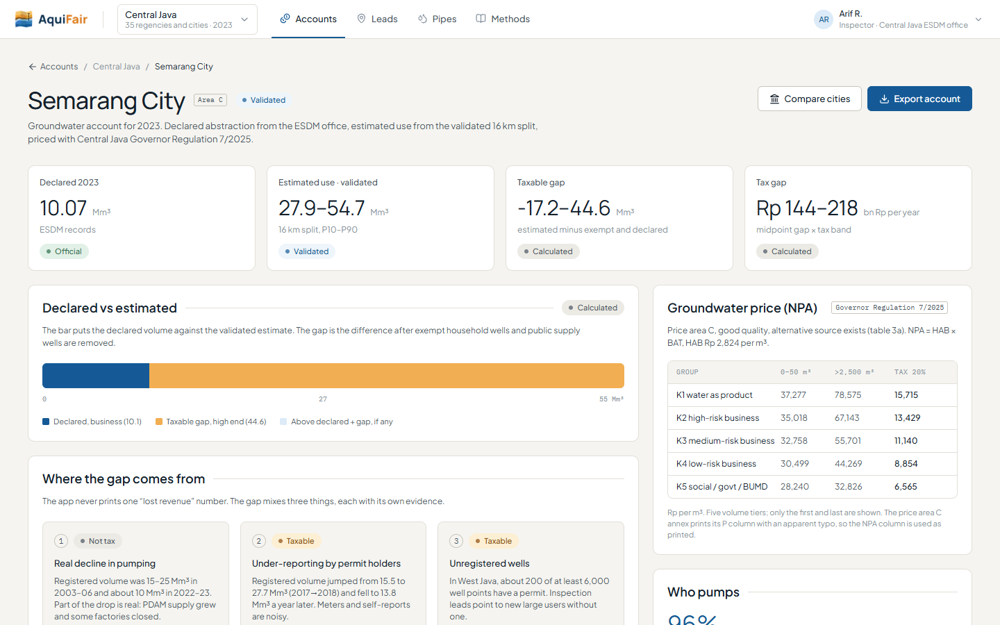
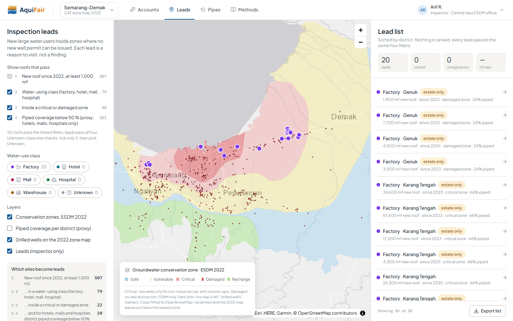
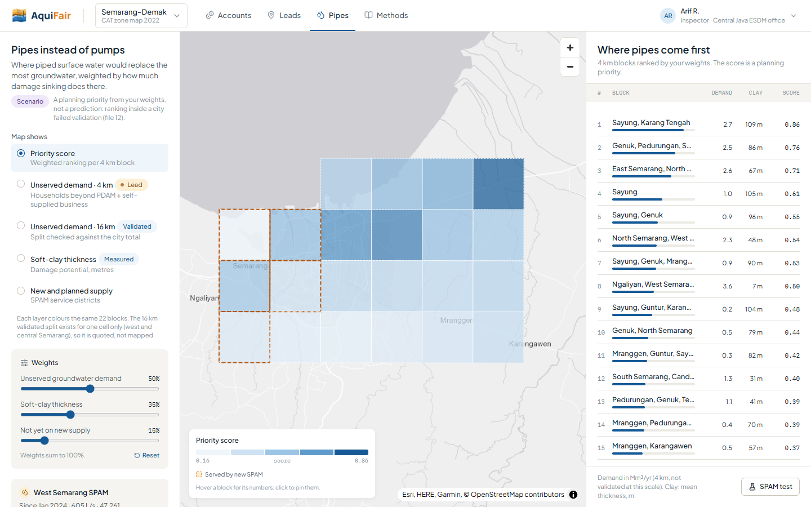

<p align="center">
  
</p>

<p align="center">
  <b>Who pumps, who pays, and where pipes should replace pumps in sinking Central Java.</b><br>
  Built for the <b>ASEAN Geospatial Challenge (AGC) 2027</b>.
</p>

<p align="center">
  <a href="https://aquifair.vercel.app"><b>Live app</b></a> ·
  <a href="https://aquifair-api.vercel.app/docs"><b>API docs</b></a> ·
  <a href="#run-it-locally"><b>Run it locally</b></a>
</p>



## The problem

Semarang is one of the fastest-sinking cities in the world, and groundwater pumping is a main
cause. On paper the city's pumping looks small: **Semarang City declared 10.07 million m³ of
groundwater in 2023**, but the validated estimate of what it actually used is **27.9–54.7
million m³**. Part of that gap is wells that are under-reported or not registered at all. That
means tax that is never billed, and pumping that never shows up in the plans meant to stop it.

AquiFair puts that gap on a map. It turns public records and satellite data into three tools,
one for each agency that can act on them.



## What it does

### A. Groundwater accounts: who pumps and who pays

For each of Central Java's **35 regencies and cities** (2020–2023), the app compares declared
abstraction with estimated use. The gap is priced with the official groundwater price table
(Central Java Governor Regulation 7/2025). Each regency opens into a full account: declared vs
estimated, taxable gap, tax at stake and where the gap comes from. The gap has three sources:
real decline, under-reporting by permit holders, and unregistered wells.





### B. Inspection leads: where to knock first

Sentinel-2 imagery (2021–2026) finds large new roofs built since 2022. Each roof goes through
four plain filters. There is no weighted score.

| Filter | Roofs left |
|---|---|
| 1. New roof since 2022, at least 1,000 m² | 507 |
| 2. Water-using class (factory, hotel, mall, hospital) | 79 |
| 3. Inside a *critical* or *damaged* conservation zone, where no new well permit can be issued | 22 |
| 4. Piped coverage below 50 % (hotels, malls and hospitals only) | **20 leads** |

Inspectors see each lead with before/after satellite chips and record what they find on site.
The public view shows only counts per district, never addresses.



### C. Pipes instead of pumps: where new supply helps most

Planners weigh unserved groundwater demand, soft-clay thickness (how much damage sinking does)
and whether a block is not yet on new supply to rank **22 blocks of 4 km** in Semarang–Demak. The weights are theirs to
set, and the map re-ranks as they move the sliders. A before/after test of the West Semarang
water supply system (SPAM) checks whether sinking slowed where pipes arrived. The honest answer
so far is *inconclusive*, and the app says so.



### Every number says how sure it is

Each figure carries a label (*official*, *measured*, *validated*, *calculated*, *scenario* or
*missing*) and links to its sources. Estimates are shown as ranges. Missing data is shown as
missing, never as zero. The **Methods** page explains how each number is built.

### Roles

The sign-in page is a role picker with no password, for the demo. Lead addresses are shown
to inspectors only.

| Role | Who | Main tool |
|---|---|---|
| Public | anyone | overview, with lead counts per district |
| Regulator | revenue agency, city council | A. Groundwater accounts |
| Inspector | provincial ESDM office | B. Inspection leads |
| Planner | water utility, planning agency, public works | C. Pipes instead of pumps |

## Data

All data is real and public. No synthetic data is used.

- **Declared abstraction and groundwater price**: Central Java ESDM office open data
  (2020–2023) and Governor Regulation 7/2025
- **Land subsidence**: Sentinel-1 InSAR (LiCSAR)
- **New buildings**: Sentinel-2 L2A dry-season composites 2021–2026, Microsoft building
  footprints, OpenStreetMap and Overture Maps places
- **Conservation zones and drilled wells**: the 2022 Semarang–Demak groundwater basin zone map,
  digitised from the official vector PDF
- **Piped coverage**: Statistics Indonesia (BPS) Semarang City 2024 and the Demak open-data
  portal 2025
- **Boundaries and coastline**: geoBoundaries, GADM and the OpenStreetMap coastline

The heavy geospatial processing runs offline (`apps/backend/scripts`). The API serves the
precomputed results.

## How it is built

```
apps/
├── web/        Next.js 16 · React 19 · Tailwind CSS v4 · MapLibre GL
└── backend/    FastAPI · Pydantic v2 · SQLAlchemy 2 · PostgreSQL · Alembic
    ├── data/      precomputed seed files the API serves
    ├── scripts/   offline builders (satellite, zone map, coastline, leads)
    └── tests/
docs/           method reports and the app guide
```

- **Web**: a desktop app (1280 px and wider) that reads everything from the API.
- **API**: read-only over the seed files, plus one write path: inspector field feedback, stored
  in PostgreSQL.
- **Hosting**: Vercel for both apps and Neon for PostgreSQL (Singapore region).

## Run it locally

You need **Node.js 20.9+**, **Python 3.12**, [**uv**](https://docs.astral.sh/uv/) and
**Docker** (for PostgreSQL).

**1. Start the API** at <http://localhost:8000>:

```bash
cd apps/backend
cp .env.example .env
docker compose up -d db          # PostgreSQL on port 55432
uv sync --dev
uv run alembic upgrade head      # create the feedback table
uv run uvicorn main:app --reload
```

Interactive API docs are at <http://localhost:8000/docs>. Without PostgreSQL the maps and
accounts still load. Only `/health` and inspector feedback need the database.

**2. Start the web app** at <http://localhost:3000>, in a second terminal:

```bash
cd apps/web
cp .env.example .env.local
npm install
npm run dev
```

If the API runs somewhere other than `http://localhost:8000/api/v1`, set `NEXT_PUBLIC_API_URL`
in `apps/web/.env.local`.

**3. Run the tests:**

```bash
cd apps/backend
uv run pytest
```

## More detail

- [`apps/backend/README.md`](apps/backend/README.md): API endpoints, data sources and the
  offline builders
- [`apps/web/README.md`](apps/web/README.md): routes, components and map layers
