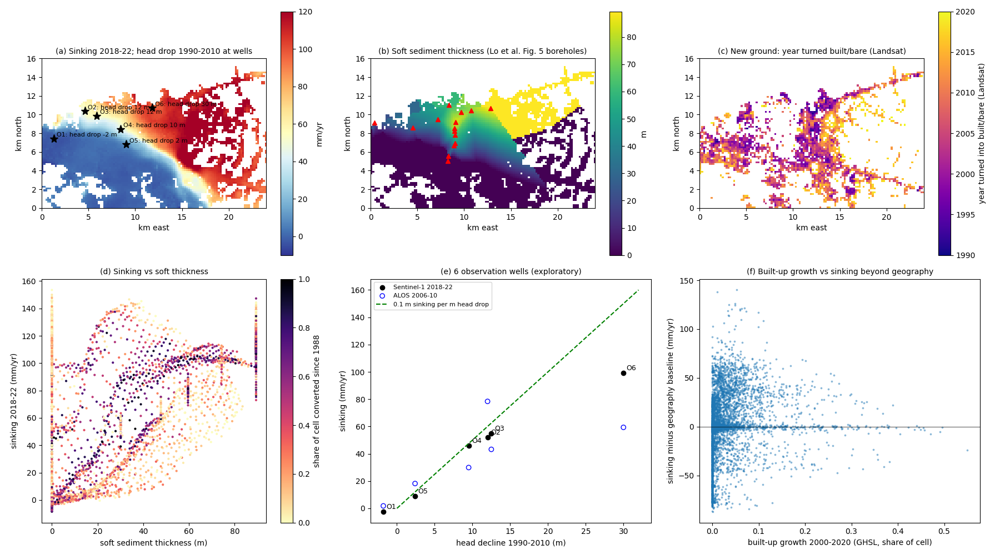

# 14 What explains the sinking in Semarang? (pre-registered, 14 + 6 experiments on the DGX Spark)

## Question
File 13 showed that the sinking map does not show where the registered wells are. So what does explain
where, and how fast, the ground sinks? Each candidate cause was tested against the Sentinel-1 2018-22 map.
The candidates were soft soil, new fill, buildings, embankments, regional pumping, large water users,
domestic wells, faults, and seasonal water.

## How it was run
- Rules fixed before any result: `../code/sx_prereg.md` (commit 4ea198e).
- **Stage 1:** 13 experiments ran in parallel on the DGX Spark (X01-X12, X14). Each downloaded its own data
  there: JRC surface water, Landsat 1988-2024, GHSL, OpenStreetMap, Copernicus DEM, SoilGrids, NASADEM,
  ERA5 rain, WorldPop, GEM faults and NGL GNSS.
- **Stage 2:** 11 jobs ran in parallel: attribution (X13) on 8 target maps, robustness across periods
  (X16), sharp edges (X19) and the stage-2 part of X08.
- **Checks added later:** a location-only check (X20, 15 jobs in parallel) and attribution at 4 and 8 km
  blocks (12 jobs). Both were added after stage 2 and are labelled as such.
- **On the laptop,** from Lo et al. 2022 (the PDF is not on the Spark):
  - L1: their pumping-model subsidence map (Fig. 14);
  - L3: soft-sediment thickness at 16 boreholes (Fig. 5 sections placed with Fig. 4);
  - L4 (exploratory): head decline at their 6 observation wells.
- **Common rules:**
  - Shift null: the driver is moved by at least 2 km, 999 draws.
  - Matched null: random cells with the same built-up and distance-to-coast quintiles.
  - "Partial": sinking minus a geography baseline (distance to coast x elevation bins).

## Results

| # | Cause tested | Key numbers | Verdict |
|---|---|---|---|
| X05 | Soft soil / young alluvium (DEM, SoilGrids, borehole clay) | block-CV R2 0.85 (geology only); clay thickness rho 0.81 (p 0.003); distance from hill foot 0.78 (p 0.001) | **pass** |
| L3 | Soft-sediment thickness, 16 boreholes (Lo et al. Fig. 5) | rho 0.79 at the boreholes; interpolated map rho 0.58 (p_shift 0.08) | supports X05 |
| X10 | Independent check: DEM change 2000 -> ~2012 (NASADEM vs Copernicus) | rho -0.37 with the 2018-22 rate (non-built land, p 0.004); fastest cells lost a median 1.0 m, about 0.7 x today's rate | **pass**: the pattern is older than the InSAR |
| X02 | New ground (Landsat: water/vegetation -> built/bare, 1988-2024) | converted land 53 vs 37 mm/yr for old built land on matching soil (p < 0.001); age rho -0.22 (p 0.15) | converted vs old: **pass**; age: fail |
| X03 | Buildings (GHSL 1975-2020) | built-up growth 2000-20 adds beyond geography (partial rho 0.41, p 0.001); built age rho -0.26 (p 0.22); volume / height: wrong sign | age, volume: fail; growth: linked (reported) |
| X16 | Same drivers in every period | stable beyond geography in 2014-17, 2018-22, 2023-26: hill distance +0.46, growth +0.40, old built land -0.43, conversion age -0.29 (each p <= 0.03) | robust (descriptive) |
| L4 | Head decline 1990-2010 at 6 observation wells (exploratory) | ranks exactly with 2018-22 sinking (rho 1.0, exact p 0.0014); ALOS rho 0.83 (p 0.03) | strong but n = 6, not pre-registered |
| X06 | Drawdown from the 74 registered wells x soft soil | soil alone R2 0.92; adding drawdown +0.03 (null 95 % 0.03, p 0.18) | fail |
| L1 | Lo et al. pumping-model bowls (Fig. 14, 2010) | 58 vs 63 mm/yr matched (p 0.98) | fail |
| X11 | Large water users (OSM industry, hotels, malls, hospitals, ...) | 37 vs 53 mm/yr matched: they sit on **slower** ground | fail |
| X12 | Many small domestic wells (WorldPop) | density partial rho -0.54 (wrong sign) | fail |
| X01 | Land reclaimed from water (JRC surface water 1984-2021) | 41 cells: 59 vs 78 mm/yr matched | fail |
| X04 | Embankments (toll roads, rail, dikes, runway) | on-line minus ring -5.5 mm/yr (p 0.67); the airport runway alone +10.8 (p 0.04) | fail (runway reported) |
| X19 | Sharp sinking edges along fill / building boundaries | no feature beats the shift null (all p >= 0.2) | fail |
| X09 | Faults, tilt, uplift | no GEM fault crosses the grid; uplift on 0.3 % of land; no horizontal contraction pattern (p 0.26) | not supported |
| X07 | Seasonal motion | 13 % of fast cells significant (AR-corrected; 20 % plain), phase uniform citywide; lowest in mid-February, about 19 days after peak rain | fail; looks like radar weather, not aquifer breathing |
| X08 | Change over time / pumping response | fast-area median 113 (2014-17) -> 103 (2018-22) -> 89 mm/yr (2023-26); 99 % of fast cells slowed; not more at registered wells (p 1.0); not linked to ground age (stage 2, p 0.93) | slowdown real, cause open |
| X14 | GNSS | no open station within ~1 degree (NGL list, 20,168 stations) | no data |

**Attribution (X13).** Grouped Shapley split of block-CV R2, 2018-22 map:

| Blocks | All causes | Soil / geology | New ground / buildings | Pumping proxies* | Coordinates only (X20) |
|---|---|---|---|---|---|
| 2 km (pre-registered) | 0.95 | 0.72 | 0.15 | 0.07 | 0.955 |
| 8 km (added after X20) | 0.85 | 0.80 | 0.10 | -0.05 | 0.66 |

\* Pumping proxies: registered-well drawdown, large water users and population. None of them measures head
decline itself.

At 2 km, x/y coordinates alone predict as well as everything else, so 2 km blocks mostly measure
interpolation. At 8 km, the model must predict areas it has never seen. There, soil and geology beat
location (0.82 vs 0.66, X20); new ground adds about 0.03 and the pumping proxies make it worse. The same
split holds for 2014-17 and 2023-26.

## L4 detail: sinking follows the fall of the water table (exploratory)

| Well | Head drop 1990-2010 (m) | Soft sediment (m) | Sinking 2018-22 (mm/yr) | 0.1 m per m rule (mm/yr) |
|---|---|---|---|---|
| O1 Prawiro Jaya Baru | rose 1.8 | ~0 | -2 | 0 |
| O5 Hotel Santika | 2.4 | 42 | 9 | 12 |
| O4 Wot Gandul | 9.5 | 67 | 46 | 48 |
| O2 PRPP | 12 | 34 | 52 | 60 |
| O3 SMKN 10 | 12.5 | 44 | 55 | 62 |
| O6 LIK Kaligawe | 30 | 83 | 99 | 150 |

- **Sources:** head drops were read by eye from the Fig. 14 insets (observed curves). The 0.1 m of sinking per
  1 m head drop is the paper's own rule, applied to the 1990-2010 head-drop rate.
- **O5 is the key well.** It has 42 m of soft sediment but almost no head drop, and it sinks only 9 mm/yr.
  - Thick clay alone does not make the ground sink fast; the water pressure must fall.
  - This also caps natural self-weight compaction plus loading at roughly 10 mm/yr for 40 m of clay.
- **Caveats:**
  - Only 6 points, read by eye; heads are for 1990-2010 and sinking for 2018-22.
  - O1 and O6 were placed from their labels (about 100 m uncertainty).
  - The 0.1 ratio comes from a model calibrated in the same city.
  - An older study measured a much smaller ratio (0.7-1.1 m/yr head decline with 0.5-1.75 cm/yr sinking,
    1980-2000; Fahrudin & Najib 2012).

## Verdict (plain English)
1. **Where it sinks = where the soft young clay is thick.** Thickness grows from the southern hills to the
   north-east coast: about 20 m in the west, 85-90 m on the north-east coast. This predicts about 80 % of
   the pattern even in areas the model has not seen. The same pattern already existed in 2000-2012 (X10)
   and in 2006-10 (ALOS).
2. **What squeezes the clay is most likely the falling groundwater pressure in the deep aquifer.** This is
   pumping, but acting regionally. The evidence:
   - At the 6 monitoring wells, sinking ranks exactly with head decline (exploratory).
   - Thick clay with no head drop barely sinks (O5).
   - Published studies agree (see sources).

   The pressure falls over the whole northern city, not just next to each well. That is why the positions of
   registered wells, factories or people do not line up with the bowls (file 13, X06, X11, X12).
3. **New ground and new buildings add extra sinking on top.** This is about 10 % of the explained pattern.
   - Land turned from ponds or fields into built/bare ground since 1988 sinks about 16 mm/yr faster than old
     built land on similar soil.
   - Areas built up after 2000 sink faster than geography alone predicts.
   - The airport runway on reclaimed land sinks about 11 mm/yr more than its surroundings.
4. **Not supported:**
   - reclamation alone (JRC map);
   - embankments in general;
   - faults (none mapped across the grid);
   - seasonal aquifer breathing: the signal looks atmospheric, as Arimoto et al. also found no clear
     seasonal effect;
   - large water users;
   - domestic wells.
5. **It is slowing.** The fastest areas went from 113 to 89 mm/yr between 2014-17 and 2023-26. This could be
   less pumping, the clay running out of easy compaction, or both. The data cannot tell which.

## Limits
- **Natural compaction** cannot be split from pumping-driven compaction with maps alone. Both scale with clay
  thickness. O5 suggests natural compaction plus loading is small, about 10 mm/yr at most.
- **Head data** come from 6 wells, read from a figure. A real test needs the ESDM / ABT monitoring-well
  network: head time series for 2015-2025 at many wells. Then pre-register "sinking per metre of clay
  rises with head decline".
- **Soft-sediment thickness** is interpolated from boreholes on two section lines. East of borehole H it is
  extrapolated (about 89 m everywhere), so the scatter in panel (d) shows vertical stripes.
- **Seasonal timing** may reflect the troposphere; GACOS did not reduce noise earlier (file 02).
- **The 8 km-block attribution** was added after the pre-registered 2 km version, once X20 showed that the
  2 km version mostly measures interpolation.

## Files
- **Code** (`../code/`):
  - `sx_prereg.md` (rules + results)
  - `sx_bundle.py` (laptop -> bundle)
  - `sx_common.py`, `sx_osm.py`
  - `sx_X01.py` .. `sx_X14.py`, `sx_X16.py`, `sx_X19.py`, `sx_X20.py`
  - `sx_run.sh`, `sx_run2.sh`
  - `sx_L1.py`, `sx_L3.py`, `sx_L4.py`, `sx_fig.py`
- **Results:** `realdata/semarang/sx/out/` (all JSON, feature maps `feat_*.npz`, `L3_boreholes.csv`,
  `L1_fig14.png`, `sx_summary.png`); on the Spark in `~/sx_data/out` (downloads in `~/sx_data`).

## Sources
- Lo et al. 2022, Water 14:201 (Figs. 3-5, 12, 14; CC BY).
- [Aditiya & Ito 2023, IJAEOG](https://doaj.org/article/bc659cefcb624b38a679829477d8e2d1): groundwater
  vs deformation correlation 0.86; maximum rate 100-120 mm/yr in north and east Semarang and Demak.
- [Fahrudin & Najib 2012, Teknik](https://ejournal.undip.ac.id/index.php/teknik/article/download/1682/1441):
  piezometric decline 0.7-1.1 m/yr in the confined aquifer.
- [Arimoto et al., JpGU 2013](https://www2.jpgu.org/meeting/2013/session/PDF/S-TT57/STT57-03_E.pdf): ALOS,
  aquifer extraction, no clear seasonal effect.
- [Chaussard et al., Sinking cities in Indonesia](https://earth.esa.int/eogateway/documents/20142/37627/Sinking-cities-Indonesia-space-geodetic-evidence-rates-spatial-distribution-land-subsidence.pdf):
  groundwater extraction and building loads.
