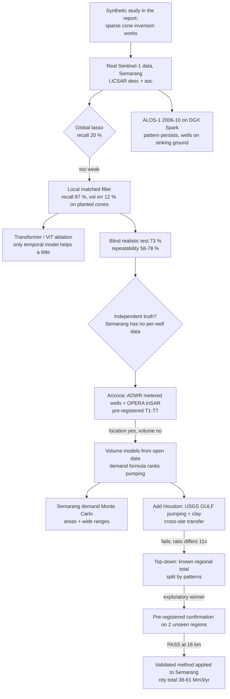

# Experiments log: groundwater audit from space (real data)

This folder documents every real-data experiment run on the groundwater-audit method between
2026-11-16 and 2026-11-18: what was tried, how it was checked, what it showed, and where the code and
results are. The synthetic study that the report (`../tex`) is built on is not repeated here.

**Start with [00-state-of-the-art.md](00-state-of-the-art.md)**: the current best method and its
honest limits.

## Files

| # | File | Topic |
|---|---|---|
| 00 | [00-state-of-the-art.md](00-state-of-the-art.md) | Current best result (temporary final) |
| 01 | [01-data-sources.md](01-data-sources.md) | All datasets, sites, access notes |
| 02 | [02-semarang-detector.md](02-semarang-detector.md) | Global lasso vs local matched filter, planted-cone tests |
| 03 | [03-ml-transformer-ablation.md](03-ml-transformer-ablation.md) | Transformer / ViT ablation for the rate map |
| 04 | [04-blind-and-repeatability.md](04-blind-and-repeatability.md) | Blind realistic test, repeatability across years and tracks |
| 05 | [05-arizona-validation.md](05-arizona-validation.md) | Arizona metered-pumping validation T1-T7 |
| 06 | [06-volume-models-arizona.md](06-volume-models-arizona.md) | Predicting pumping volume from data (formula vs ML) |
| 07 | [07-semarang-demand-model.md](07-semarang-demand-model.md) | Semarang water-demand Monte Carlo (areas + ranges) |
| 08 | [08-cross-site-transfer.md](08-cross-site-transfer.md) | Arizona <-> Houston transfer with clay thickness |
| 09 | [09-validated-regional-split.md](09-validated-regional-split.md) | Known total split by sqrt(demand x subsidence): validated |
| 10 | [10-alos1-2006-2010.md](10-alos1-2006-2010.md) | ALOS-1 PALSAR 2006-2010 on the DGX Spark |
| 11 | [11-negative-results-and-lessons.md](11-negative-results-and-lessons.md) | What failed and should not be retried |

## Summary table

"Pass/fail" refers to criteria fixed before the test where a pre-registration exists
(`../code/az_prereg.md`, `../code/xsite_prereg.md`).

| # | Experiment | Site | Truth used | Key result | Verdict |
|---|---|---|---|---|---|
| 02a | Global sparse lasso on real InSAR | Semarang | planted cones | recall 20 %, vol err 34 % (q = 100) | too weak |
| 02b | Local matched filter (K0 cone + local quadratic) | Semarang | planted cones (500 x 2 seeds) | recall 87 %, vol err 12 %, 0.22 false/trial | goal met (planted) |
| 03 | Transformer / ViT ablation | Semarang | injected signals on stable ground | only temporal transformer t0_24 better (MAE 2.14 vs 2.70 mm/yr) | ViT no gain |
| 04a | Blind realistic planted fields | Semarang | hidden varied cones | recall 73 %, vol err 61 % | detection ok, volume not |
| 04b | Repeatability | Semarang | independent periods / tracks | 58-64 % (null 27 %), 78 % across tracks | signals real |
| 05 T1 | Detections near metered pumping | Arizona | ADWR meters | 61 % vs 22 % random; 59 % for other sinking ground | pass / fail |
| 05 T2 | Map vs pumping-predicted subsidence | Arizona | ADWR meters | rho 0.22, p 0.03 | pass |
| 05 T3 | Volume per detection | Arizona | ADWR meters | rho 0.17, hold-out error 68 % | fail |
| 05 T4 | Change over time | Arizona | ADWR meters | rho -0.04 / 0.06 | fail |
| 05 T5 | Subsidence vs water-level decline | Arizona | ADWR GWSI heads | rho 0.30, p 0.003 | pass |
| 05 T6 | Volume ranges from literature ratio | Arizona | ADWR meters | coverage 6 % | fail |
| 05 T7 | Transferable calibration methods | Arizona | ADWR meters | no method beats regional mean | fail |
| 06 | Volume models, 4 km blocks | Arizona | ADWR meters | demand formula ranks best (rho 0.49-0.61), totals -79..+101 % | ranking only |
| 07 | Semarang demand Monte Carlo | Semarang | published city total | 25-48 vs 38-61 Mm3/yr | consistent, not validated |
| 08 | Cross-site transfer + clay | Arizona <-> Houston | ADWR + USGS GULF | error factor 5-27; ratio 2.5 % vs 28 % | fail |
| 09a | Known total split, unweighted | Arizona <-> Houston | ADWR + GULF | best 16 km 0.36 (one direction) | fail |
| 09b | Same, volume-weighted, unseen regions | Arizona ESRV, Texas west | ADWR + GULF | 0.16 / 0.14 (within ~1.5x) | **pass (validated)** |
| 10 | ALOS-1 2006-10 rate map | Semarang | Sentinel-1 2018-22, wells | r 0.72; wells on faster-sinking ground p 0.0095 | pattern persistent |

## Flowchart

## Where things are

- Code: `../code/` (`real_*.py` Semarang, `az_*.py` Arizona, `xs_*.py` cross-site, `sem_*.py` Semarang
  output, `alos_*` ALOS-1; intermediates on the DGX Spark in `~/alos_work`). Pre-registrations:
  `../code/az_prereg.md`, `../code/xsite_prereg.md`.
- Data and result JSONs: `realdata/` at the repo root (git-ignored, several GB).
- Web explainer (earlier state, up to the Semarang demand model): https://claude.ai/artifact/F3nQh6CoEEM7AtoMR66ojm
